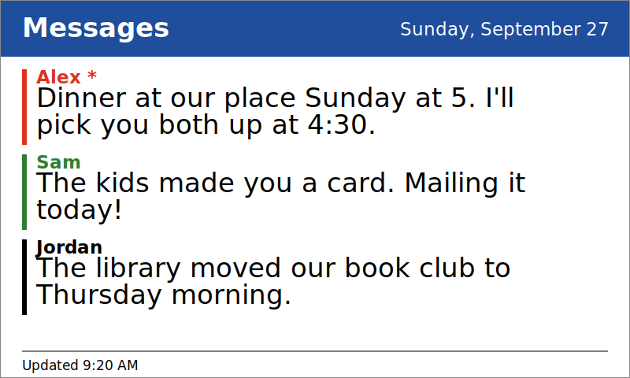

# PhotoPainter Message Board

Turn a Waveshare ESP32-S3-PhotoPainter (a 7.3-inch full-colour e-paper picture frame)
into a message board. People on an approved list send an email to a Gmail address you
set up. The message appears on the frame in large type within about 20 minutes, or
straight away if someone presses the boot button on the back.

I set this up so that I could support my aging parents. It allows my brother or I to 
set up reminders for upcoming appointments and such. eInk has the advantage of being
easily readable while not give off any light so can be kept in a bedroom.



This is alternative firmware. It replaces the frame's stock software, which can't do
this. It is not made or supported by Waveshare. The code for this project as well as 
the full instrucitions were craeted by Claude running Opus 5.5.

**What you will end up with**

- A Gmail address that receives messages, and a small script that reads them.
- A picture frame on a wall or shelf that shows the latest messages.
- A frame that wakes up every 20 minutes, checks for new mail, and only redraws the
  screen when something has changed. It sleeps the rest of the time.

**How long it takes:** about 1 to 2 hours the first time, most of it waiting for
downloads. You do not need to know how to program. You will copy and paste code and
change a few settings.

---

## Contents

1. [What you need](#1-what-you-need)
2. [Part 1: Set up the Gmail side](#2-part-1-set-up-the-gmail-side)
3. [Part 2: Install the Arduino software](#3-part-2-install-the-arduino-software)
4. [Part 3: Get the code onto the frame](#4-part-3-get-the-code-onto-the-frame)
5. [Part 4: Test it](#5-part-4-test-it)
6. [Using the board](#6-using-the-board)
7. [Settings reference](#7-settings-reference)
8. [Troubleshooting](#8-troubleshooting)
9. [How it works](#9-how-it-works)
10. [Battery](#10-battery)
11. [Tests and development notes](#11-tests-and-development-notes)

---

## 1. What you need

| Item | Notes | Where to get it |
|---|---|---|
| **Waveshare ESP32-S3-PhotoPainter** | The frame. Make sure the listing says **7.3-inch E6 full-colour e-paper** and 800 × 480 resolution. Other sizes need different code. | [Waveshare product page](https://www.waveshare.com/esp32-s3-photopainter.htm) · [Amazon (US search)](https://www.amazon.com/s?k=ESP32-S3-PhotoPainter) · [Eckstein Shop (Germany)](https://eckstein-shop.de/waveshare-esp32-s3-photopainter-7-3inch-e6-fullcolor-epaper-frame_1) |
| **USB-C cable** | It must carry data, not just power. Many cheap cables are charge-only. If the computer shows nothing when the frame is plugged in, try another cable. | Any phone or laptop shop |
| **A computer** | Windows, Mac or Linux. | You already have one |
| **Wi-Fi network** | It must be **2.4 GHz**. Most home routers offer this. The frame cannot join a 5 GHz-only network. | Your home router |
| **A Google account** | Used to create the dedicated message Gmail address. | <https://accounts.google.com> |

Prices change, so check the listing. The frame is sold with its e-paper panel already
attached. You do not need to buy the panel separately.

**Useful references**

- Waveshare's wiki for the board: <https://www.waveshare.com/wiki/ESP32-S3-PhotoPainter>
- Waveshare's own demo code, if you want to see more: <https://github.com/waveshareteam/ESP32-S3-PhotoPainter>
- Arduino IDE (the program you will use to put code on the frame): <https://www.arduino.cc/en/software>
- Google Apps Script (the free Google service that reads the mail): <https://script.google.com>

---

## 2. Part 1: Set up the Gmail side

This part happens in a web browser. It takes about 20 minutes.

### Step 1: Create a Gmail account for the board

1. Go to <https://accounts.google.com/signup> and create a new Gmail account. Choose a
   name the family will recognise, such as `smith.family.board@gmail.com`.
2. **Use a new account, not your personal one.** The script moves messages in and out
   of this account's inbox, so it should not be an inbox you use for other things.

### Step 2: Create the script

1. Sign in to the new account and go to <https://script.google.com>.
2. Click **New project**.
3. At the top left, click **Untitled project** and rename it to `Message Board`.
4. In the file list on the left, click **Code.gs**. You will see some placeholder code.
5. Click inside the editor, press **Ctrl+A** (Windows) or **Cmd+A** (Mac) to select
   everything, and delete it.
6. Open `apps-script/Code.gs` from this project in a text editor. Copy the whole file
   and paste it into the Apps Script editor.

### Step 3: Change the three settings at the top

Near the top of `Code.gs` there are three settings to change:

**`SHARED_SECRET`** is a password the frame uses to prove it is allowed to read the
messages. Replace the placeholder with a long random string of letters and numbers, at
least 30 characters. Write it down. You will type the exact same text into the frame's
settings in Part 3.

Example of the format (make up your own, do not use this one):

```
const SHARED_SECRET = 'k7Qp2mZx9RtL4vWc8NbY3sHf6JaD1eGu';
```

**`ALLOWED_SENDERS`** is the list of email addresses allowed to post to the board.
Anyone not on this list is ignored. Replace the examples with the real addresses of
the people who should be able to post. Each one goes in quotes with a comma after it:

```
const ALLOWED_SENDERS = [
  'grandma@example.com',
  'jordan.smith@example.com',
];
```

To allow everyone at one domain, start the entry with `@`, for example `'@example.org'`.
Use this carefully: it allows anyone with an address at that domain.

**`MAX_MESSAGES`** is how many messages the script sends to the frame, up to 8.
About 4 fit on screen. Any that don't are counted at the bottom as "+2 more
messages". The default of 4 is fine. You can leave it alone.

Click the **save** icon (or press **Ctrl+S** / **Cmd+S**). Apps Script saves
automatically too, but saving makes sure.

**Check the time zone.** Click the gear icon (**Project Settings**) on the left and
make sure **Time zone** is where the frame lives. The script uses it to decide when a
pinned date has passed.

### Step 4: Give the script permission to read the account

1. In the toolbar above the code, use the dropdown that says `myFunction` (or
   similar) and choose **testBoard**.
2. Click **Run**.
3. A window says **Authorization required**. Click **Review permissions**.
4. Choose the Gmail account you created.
5. You will see **Google hasn't verified this app**. This is expected: you wrote this
   script yourself, so Google has not reviewed it. Click **Advanced**, then click
   **Go to Message Board (unsafe)**. Read the list of permissions, which should be
   Gmail and external web requests, and click **Allow**.
6. Click **Run** again. At the bottom of the screen, open **Execution log**. It should
   say `count: 0` if nothing has been sent yet, or list the messages it found.

If you get an error here, see [Troubleshooting](#8-troubleshooting).

### Step 5: Publish the script as a web app

1. Click **Deploy** (top right), then **New deployment**.
2. Next to "Select type", click the gear icon and choose **Web app**.
3. Set these two options:
   - **Execute as:** `Me`
   - **Who has access:** `Anyone`
4. Click **Deploy**. If asked, authorize again the same way as Step 4.
5. You will see a **Web app URL**. It starts with `https://script.google.com/macros/s/`
   and ends with `/exec`. Click the **Copy** button next to it and save it somewhere.
   You will paste it into the frame's settings in Part 3.

"Anyone" sounds public, but it is safe here: the script returns nothing without the
correct `SHARED_SECRET`.

**To check it works:** open a new browser tab and paste the web app URL, then add
`?key=` followed by your secret at the end. For example:

```
https://script.google.com/macros/s/AKfy.../exec?key=k7Qp2mZx9RtL4vWc8NbY3sHf6JaD1eGu
```

You should see text beginning with `{"generated":...`. If you see `{"error":"unauthorized"}`,
the secret in the link does not match `SHARED_SECRET`.

> **Changing the script later:** make the edit, then go to **Deploy → Manage
> deployments**, click the pencil icon, set **Version** to **New version**, and click
> **Deploy**. The web app URL stays the same, so the frame keeps working. Do *not* click
> **New deployment** for an update. That creates a new URL, and the frame would stop
> finding the messages.

### How people use the board

Send an email to the board's Gmail address from one of the approved addresses.

| What to do | Result |
|---|---|
| Send a normal email | It appears on the board. The subject is ignored. |
| Use the subject `pin`, or start the subject with `!` | The message stays at the top, with a red bar, for up to 21 days. Replies to it stay pinned. |
| Use the subject `Pin` followed by a date, such as `Pin 10/25` | The message stays at the top through that whole day, then disappears shortly after midnight. |
| Use the subject `clear` | Everything sent before it is wiped. Messages sent after it stay. |
| Archive a message in the board's inbox | It disappears from the frame. |

Replies to a message update it rather than adding a second copy. Quoted text,
signatures and "Sent from my iPhone" are removed automatically. Messages older than
21 days are ignored, except ones pinned to a date that hasn't arrived yet.

**Pinning to a date.** Put the date right after `Pin` in the subject. Anything after
the date is ignored, so `Pin 10/25 Dentist` works. All of these work:

| Subject | Pinned through |
|---|---|
| `Pin 10/25`, `Pin 10-25`, `Pin 10/25/26` | October 25 (month first, as written in the US) |
| `Pin Oct 25`, `Pin October 25th`, `Pin 25 October` | October 25 |
| `Pin Sat 10/25`, `Pin Saturday, Oct 25` | October 25 (the weekday is ignored when there's a date) |
| `Pin Saturday` | The coming Saturday, or today if it is Saturday |
| `Pin today`, `Pin tomorrow` | Today, or tomorrow |
| `Pin 2026-10-25` | October 25, 2026 |

Without a year, the script picks the nearest October 25: this year's, or next year's
if the date is close to New Year. A date that has already passed means the message
never shows, so check the date before sending. If the date can't be understood, the
message is pinned with no end date, like a plain `pin`. Run `testBoard` to see how a
subject was read. It lists each pin as, for example, `(pinned through 2026-10-25)`.

---

## 3. Part 2: Install the Arduino software

Arduino is the free program you use to put code onto the frame. You do not need to
learn Arduino programming for this project.

### Step 1: Install Arduino IDE 2

1. Go to <https://www.arduino.cc/en/software>.
2. Download **Arduino IDE 2** for your computer and install it as you would any other
   program. Accept the defaults.
3. Open it. You will see an empty window, or a sketch called `sketch_…`. Leave it
   alone for now.

> **Mac with Apple Silicon (M1, M2, M3 or newer):** the first build may fail with
> `bad CPU type in executable`. Open Terminal and run
> `softwareupdate --install-rosetta --agree-to-license`. Then restart Arduino and try again.

### Step 2: Install the ESP32 board support

The frame uses an ESP32-S3 chip. Arduino needs an add-on called "board support" to
understand it.

1. In the left sidebar, click the **Boards Manager** icon. It looks like a circuit
   board with a download arrow. (Or use the **Tools** menu → **Board** → **Boards Manager**.)
2. In the search box, type `esp32`.
3. Find the entry called **esp32** by **Espressif Systems**. Make sure the author is
   Espressif, not someone else with a similar name.
4. Click **Install**.

This is a large download, often several hundred megabytes. It can take 10 to 20
minutes. Wait for the progress to finish before going on.

### Step 3: Install the libraries

Libraries are ready-made pieces of code that the project uses to drive the screen and
read the web.

1. In the left sidebar, click the **Library Manager** icon. It looks like a stack of
   books.
2. Search for each of these and click **Install** on each one:

| Search for | Publisher | Install |
|---|---|---|
| `GxEPD2` | Jean-Marc Zingg | The newest version |
| `Adafruit GFX Library` | Adafruit | The newest version |
| `ArduinoJson` | Benoit Blanchon | **Version 7.x** (not 6.x) |

If a window asks whether to install **dependencies** (extra libraries that the one you
chose needs), click **Install All**.

### Step 4: Open the project

1. Click **File → Open**.
2. Go into this project's `firmware` folder, then `MessageBoard`.
3. Select **MessageBoard.ino** and click **Open**.

Arduino opens the sketch and also shows tabs for the other files in the same folder
(`config.h`, `pmu.h`, `panel.h`, `board_pins.h`). You will edit `config.h` next.

**Keep the folder and file names exactly as they are.** Arduino requires a sketch
folder to have the same name as its main `.ino` file.

### Step 5: Set the board options

Click the **Tools** menu. Set each of these, exactly as shown:

| Tools menu item | Set it to |
|---|---|
| **Board** | **ESP32S3 Dev Module** (under the esp32 group) |
| **USB CDC On Boot** | **Enabled**. Without this, you see no serial messages at all. |
| **Flash Size** | **16MB (128Mb)**. The board has 16 MB of memory. |
| **Flash Mode** | **QIO 80MHz** |
| **Partition Scheme** | **16M Flash (3MB APP/9.9MB FATFS)** |
| **PSRAM** | **OPI PSRAM** |

The PhotoPainter does not appear by name in the Board list. Choosing the generic
"ESP32S3 Dev Module" with these settings is the correct approach, and it matches
Waveshare's own instructions. Leave the other settings at their defaults.

---

## 4. Part 3: Get the code onto the frame

### Step 1: Edit `config.h`

`config.h` is one of the tabs in Arduino. Click it. Replace the capitalised
placeholders with your own values:

```c
#define WIFI_SSID      "YOUR_WIFI_NAME"        // exact name, upper and lower case matter
#define WIFI_PASSWORD  "YOUR_WIFI_PASSWORD"

#define SCRIPT_URL     "https://script.google.com/macros/s/PASTE_YOUR_DEPLOYMENT_ID_HERE/exec"
#define SHARED_SECRET  "CHANGE-ME-to-a-long-random-string"
```

- **`WIFI_SSID` and `WIFI_PASSWORD`**: your Wi-Fi name and password, in quotes.
- **`SCRIPT_URL`**: the Web app URL you copied at the end of Part 1, Step 5. Paste the
  whole thing, from `https://` to `/exec`.
- **`SHARED_SECRET`**: the **exact same text** as in `Code.gs`. One wrong character
  and the frame gets `unauthorized`.

Leave the other settings alone for now. The file explains each one, and
[Settings reference](#7-settings-reference) below lists them. The time zone is set for
US Eastern. If you live elsewhere, change `TZ_STRING`. The file has a table of the
common ones.

Save with **Ctrl+S** or **Cmd+S**.

> **Keep this file private.** Once you have typed in your Wi-Fi password and secret,
> this file contains them. Do not upload it to GitHub, post it online or send it to
> anyone outside the household. If you share this project, send a copy with the
> placeholders restored.

### Step 2: Connect the frame

1. Plug the USB-C cable into the frame's USB-C port.
2. Plug the other end into your computer. The frame may not light up or show anything
   yet. That's normal.

### Step 3: Choose the port

1. Click **Tools → Port**. You should see a new entry that wasn't there before you
   plugged the frame in. Its name depends on your computer:
   - Mac: something like `/dev/cu.usbmodem...`
   - Windows: something like `COM5`
   - Linux: something like `/dev/ttyACM0`
2. Select that entry.

**If no new port appears:**

1. Unplug the cable and plug it in again. Try a different USB port on the computer.
2. Try a different cable. A charge-only cable shows nothing.
3. Put the frame into download mode: hold the **PWR** button for about 5 seconds to
   switch it off. Then hold the **BOOT** button, press and release **PWR**, and release
   **BOOT**. Look at **Tools → Port** again.

### Step 4: Upload the code

1. Click the **Upload** button, the right-pointing arrow at the top left of the
   window.
2. The first time takes several minutes, because Arduino compiles the code and the
   ESP32 support. Later uploads are quicker.
3. Watch the black panel at the bottom of the window. When it reads
   **Done uploading** or **Hard resetting via RTS pin**, the code is on the frame.

If the upload fails with an error, see [Troubleshooting](#8-troubleshooting).

### Step 5: Watch the first cycle

1. Click the **Serial Monitor** button, the magnifying-glass icon at the top right.
2. Check that the speed box at the top right says **115200**. The setting is often
   ignored over this USB connection, but matching it avoids garbled text.
3. Press the **BOOT** button on the frame to start a check straight away.

You should see messages appear in this order:

```
=== wake #1 (button) ===
battery 4012 mV, 82%
wifi ok, 192.168.1.23, rssi -52
fetched 2 messages, hash 3f9a...
rendering (2 messages)
...
sleeping 1180s
PMU: asleep, rails off
```

The exact numbers will differ. Once you see `rendering`, the screen starts to
refresh. It takes about 25 seconds, and it flashes black, white and colour several
times. That is normal. Do not unplug the frame during a refresh.

Once you see `sleeping`, the frame is set up. Unplug it from the computer and plug it
into any USB phone charger or power bank. It will work from wall power or from a
battery, and it does not need a computer connected to run.

---

## 5. Part 4: Test it

1. From an approved email address, send an email to the board's Gmail address. Give
   it a short subject, such as `test`, and a body of a sentence or two.
2. Press **BOOT** on the frame. It checks for mail straight away, and the screen
   redraws if there is something new.
3. If it doesn't appear, open the Apps Script editor, choose **testBoard**, and click
   **Run**. Look at the **Execution log**. It lists every message the board found, and
   the reason any were skipped.
4. Once it works, the board checks every 20 minutes by itself.

---

## 6. Using the board

**Buttons on the frame**

| Button | What it does |
|---|---|
| **BOOT** | Checks for new messages now and redraws the screen if something changed. |
| **PWR** | Hold for a few seconds to switch the frame fully off. |

**When does it update?**

- Within about 20 minutes of a new message arriving. The check interval is set by
  `CHECK_INTERVAL_MINUTES`.
- It doesn't redraw the screen if nothing has changed, so it stays quiet most of the
  time.
- It redraws once a day regardless, so the date is always correct.
- If the Wi-Fi goes down, the last good messages stay on screen. After about 12 hours
  of failures, a "Not connected" notice appears so nobody reads stale messages as
  current.

**Footer**

The line at the bottom reads something like `Updated 9:20 AM - 82%`. The time is when
the board last refreshed. The percentage is the battery level, and it only shows if
the frame has a battery. It reads `charging 64%` while the battery is charging. Below
15%, the footer turns red and asks for a charge.

If there are more messages than fit on the screen, the right-hand side of the footer
says how many are hidden, for example `+2 more messages`. The newest messages and any
pinned ones are shown first.

---

## 7. Settings reference

Everything here is in `config.h`, except the Gmail settings in `Code.gs`.

| Setting | Default | What it does |
|---|---|---|
| `WIFI_SSID` / `WIFI_PASSWORD` | placeholders | Your Wi-Fi network. Must be 2.4 GHz. |
| `SCRIPT_URL` | placeholder | Your Apps Script web app address, ending in `/exec`. |
| `SHARED_SECRET` | placeholder | Must match `SHARED_SECRET` in `Code.gs` exactly. |
| `CHECK_INTERVAL_MINUTES` | `20` | How often the frame wakes to check for mail. Lower is more responsive and uses a little more battery. |
| `DAILY_FORCED_REFRESH` | `true` | Redraw once a day even if nothing changed. Keeps the date right and helps prevent ghosting. |
| `MIN_MINUTES_BETWEEN_REFRESHES` | `30` | Minimum gap between redraws. A burst of messages becomes one redraw. Raise it for a calmer display. |
| `WIFI_TIMEOUT_MS` / `HTTP_TIMEOUT_MS` | `25000` / `20000` | How long to wait for Wi-Fi and the web app before giving up. |
| `TZ_STRING` | US Eastern | Your time zone. A table in the file lists the common ones. |
| `NTP_SERVER` | `pool.ntp.org` | Time server used to set the clock. |
| `POWER_DOWN_IN_SLEEP` | `true` | Switch off unused power circuits during sleep. This is what makes a battery last. |
| `SHOW_BATTERY` | `true` | Show the battery level in the footer. |
| `LOW_BATTERY_PERCENT` | `15` | Below this, the footer turns red and asks for a charge. |
| `DEBUG_FAST_CYCLE` | `false` | For testing only. Checks every couple of minutes and redraws every time, and shows the last check time. **Turn it off for normal use.** |
| `DEBUG_INTERVAL_MINUTES` | `2` | Check interval when `DEBUG_FAST_CYCLE` is on. |
| `BOARD_TITLE` | `Messages` | The heading across the top of the board. |
| `SCREEN_ROTATION` | `2` | `0` or `2`. Use the other value if the screen is upside down. |

In `Code.gs`:

| Setting | Default | What it does |
|---|---|---|
| `SHARED_SECRET` | placeholder | Must match `config.h`. |
| `ALLOWED_SENDERS` | two examples | Addresses allowed to post. Anything else is ignored. Start an entry with `@` to allow a whole domain. |
| `MAX_MESSAGES` | `4` | How many messages are sent to the frame (up to 8). About 4 fit; the rest are counted as "+N more" in the footer. |
| `MAX_AGE_DAYS` | `21` | Messages older than this are ignored, except ones pinned to a future date (`Pin 12/25`). |
| `MAX_CHARS` | `180` | Longest message shown. Longer ones are cut at a word boundary. |

---

## 8. Troubleshooting

Check the **Serial Monitor** first. Most problems say what's wrong there.

| What you see | What to do |
|---|---|
| Arduino says `bad CPU type in executable` (Mac) | Install Rosetta: `softwareupdate --install-rosetta --agree-to-license`, then restart Arduino. |
| Compile error: `GxEPD2_7C.h: No such file or directory` | The GxEPD2 library isn't installed. See Part 2, Step 3. |
| Compile error about `ArduinoJson` | Install ArduinoJson **version 7**, not 6. |
| No port appears in **Tools → Port** | Use a data-capable cable, try another USB port, or use download mode (Part 3, Step 3). |
| Upload fails part-way | Unplug and replug the frame, then try Upload again. If it keeps failing, use download mode. |
| Serial shows nothing at all | Check **USB CDC On Boot** is **Enabled** in the Tools menu, then upload again. |
| `wifi failed` | Check the name and password in `config.h`, exactly, including capitals. Check the network is 2.4 GHz. |
| `http 401` or `unauthorized` | `SHARED_SECRET` in `config.h` and `Code.gs` don't match. They must be identical. |
| `http 302` repeats, or `http` errors | Check `SCRIPT_URL` ends in `/exec` and was copied in full. |
| `json:` or `server error` | Open the Apps Script **Execution log** and run `testBoard` to see the cause. |
| `fetched 0 messages` but mail was sent | The sender isn't in `ALLOWED_SENDERS`, the mail went to Spam, or it's older than `MAX_AGE_DAYS`. Run `testBoard` to check. |
| The screen doesn't change after you send mail | Press **BOOT** to force a check. If the log says the hash didn't change, the messages are the same as before. |
| The screen is upside down | Change `SCREEN_ROTATION` to the other value (`0` or `2`) and upload again. |
| Accented letters or symbols look wrong | Accents are converted to plain letters. Some symbols aren't available on this display and are replaced. |
| `PMU: no response at 0x34` | The power chip was left in sleep mode with its power switched off. Unplug USB **and** the battery for 10 seconds, then reconnect. If it keeps happening, set `POWER_DOWN_IN_SLEEP` to `false`. |
| The battery drains within days | Check `POWER_DOWN_IN_SLEEP` is `true`, `DEBUG_FAST_CYCLE` is `false`, and the latest code is on the frame. |
| `panel has no power - skipping refresh` | The power chip didn't switch the screen on. The board tries again on the next wake. If it keeps happening, unplug USB **and** the battery for 10 seconds. |
| `fuel gauge reads 0% at a healthy voltage` | The battery level isn't available yet, so the footer leaves it out rather than showing a false low-battery warning. Let the battery charge fully once. |
| The screen is blank after an upload | Press **BOOT**. If nothing happens, check the serial output for an error. |

---

## 9. How it works

Each time the frame wakes:

1. It connects to Wi-Fi and sets its clock from the internet.
2. It asks your Apps Script web app for the current messages.
3. The web app sends back the messages and a short fingerprint (a hash) of their content.
4. If the fingerprint matches the last one the frame drew, it does nothing more.
5. If it's different, the frame redraws the screen. This takes about 25 seconds.
6. It goes to sleep until the next check.

The fingerprint is what saves the screen. A redraw flashes the whole display, so the
frame avoids doing it when nothing has changed.

**The frame sleeps in between.** It uses the ESP32's own timer to wake up, not a
separate clock chip. Its memory survives the sleep, so it remembers the last
fingerprint and the time of the last redraw.

**The text is simplified to plain letters.** The fonts on the board only cover basic
English characters. Curly quotes, dashes and accented letters, which are common in
email, are converted to their plain versions. Emoji are dropped.

**The screen is drawn in four strips.** A full-colour screen image needs more memory
than the board has. The firmware draws one quarter at a time, which fits.

**TLS certificate checking is off** for the call to Google. Checking the certificate
would mean the board silently stops working whenever Google renews it, with no way to
tell you. The shared secret is the real access control, and the messages are family
notes, not bank details. If you prefer to check the certificate, the change goes in
`fetchMessages()` in `MessageBoard.ino`.

---

## 10. Battery

Before each sleep, the firmware turns off the unused power circuits. These are the
audio chip and amplifier, SD card, sensors, and the panel's own power. The ESP32 stays
on. This happens whether the frame is on a battery or plugged in.

This must go through the power chip's own sleep mode. Simply switching the circuits off
leaves the other chips on the same I2C bus holding it low, so the ESP32 can't reach the
power chip to turn anything back on. On each wake, the firmware sends a short pulse to
the power chip's interrupt line (GPIO21), and the chip restores its own power.

Waveshare measured about **1.2 mA** asleep with these circuits off, compared with about
**25 mA** with everything on. On a battery, that is the difference between weeks and
days. A frame that stays plugged in gets no real benefit, but it costs nothing.

The footer shows the battery level. The fuel gauge needs a full charge cycle or two
before its percentage settles. Settings are in `config.h`: `POWER_DOWN_IN_SLEEP`,
`SHOW_BATTERY` and `LOW_BATTERY_PERCENT`.

---

## 11. Tests and development notes

The tests are optional. You only need them if you change the code.

**Text wrapping, character conversion and secret encoding** compile and run on any
computer that has a C++ compiler. The script cuts the real functions out of
`MessageBoard.ino`, so it always tests the code that ships:

```bash
cd tests
./run_text_test.sh
```

**The Apps Script** runs against fake Gmail inboxes. It covers `clear` (including
messages sent after it), pins, dated pins and how pin dates are read, replies and
reply-header stripping. It needs
[Node.js](https://nodejs.org):

```bash
cd tests
node test_apps_script.js
```

**Power-chip sleep and wake** runs against a simulated chip, so a mistake is caught
before it reaches the hardware. A wrong bit leaves the chip asleep with its power off
and no way to wake it, which on real hardware means unplugging everything:

```bash
cd tests
./run_pmu_test.sh
```

This script generates `pmu_body.inc` from the real `pmu.h`, so it tests the code that
ships. It needs `g++`. On Mac, install it with `xcode-select --install`. On Windows, use
WSL (Windows Subsystem for Linux).

**Footer width** checks that every footer message fits on the screen. It needs the
font file from the Adafruit GFX library. Copy `FreeSans9pt7b.h` from
`Adafruit_GFX_Library/Fonts/` into the `tests` folder, or pass its path:

```bash
cd tests
python3 test_footer_width.py                           # font copied into tests/
python3 test_footer_width.py /path/to/FreeSans9pt7b.h  # or give the path
```

**Layout preview:** `preview_layout.py` draws a to-scale picture of the board with
sample messages. Run it after changing the layout constants in the sketch:

```bash
cd tests
python3 preview_layout.py
```

### Repository layout

```
apps-script/
  Code.gs              Google Apps Script: reads Gmail, serves the messages
  appsscript.json      Script settings (time zone and permissions)
firmware/
  MessageBoard/        The sketch for the frame. Open MessageBoard.ino in Arduino.
    MessageBoard.ino   Main program
    config.h           Your settings: Wi-Fi, web app address, secret, behaviour
    panel.h            Screen driver fix for the panel's slow refresh
    pmu.h              Power chip control: power-down, wake, battery
    board_pins.h       Pin numbers for this board
  PanelTest/           A separate test sketch. Use it only to check the screen works.
tests/                 Tests and the layout preview
```

### Notes for teachers

The deep-sleep-and-compare-a-fingerprint pattern is the main lesson. The expensive
operation is the screen refresh, so the interesting engineering is deciding *not* to do
it. The Apps Script half is a gentle introduction to web APIs. Students can paste the web
app address into a browser with `?key=` added and see the JSON their code will read.

---

*This project is not affiliated with or endorsed by Waveshare.*
